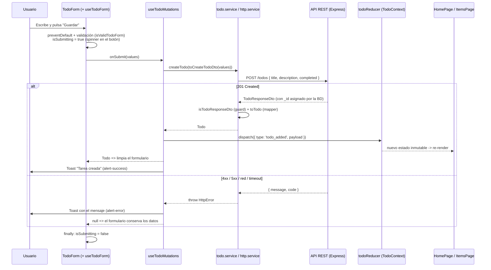

# Conceptos clave: React + TypeScript consumiendo una API REST

> Documento de referencia teórica del proyecto **EA-Exercise-React** (BackOffice de tareas).
> Cada sección incluye **qué es** (definición), un **ejemplo real** extraído de `src/` y **por qué** se ha diseñado así.
> Los fragmentos de código están copiados del proyecto: búscalos en el fichero indicado para verlos en su contexto.

## Índice

0. [Arquitectura de capas del cliente](#0-arquitectura-de-capas-del-cliente)
1. [**Consumo de APIs REST en React**](#1-consumo-de-apis-rest-en-react)
   1. [Aislamiento de las llamadas HTTP en `src/services/`](#11-aislamiento-de-las-llamadas-http-en-srcservices)
   2. [Tipado de endpoints y DTOs con TypeScript](#12-tipado-de-endpoints-y-dtos-con-typescript)
   3. [Ciclo de vida asíncrono: Cargando, Éxito y Error](#13-ciclo-de-vida-asíncrono-cargando-éxito-y-error)
   4. [Manejo defensivo de errores: `try` / `catch` / `finally`](#14-manejo-defensivo-de-errores-try--catch--finally)
   5. [Sincronización del estado con la base de datos remota](#15-sincronización-del-estado-con-la-base-de-datos-remota)
   6. [Cancelación de peticiones y *race conditions*](#16-cancelación-de-peticiones-y-race-conditions)
2. [Virtual DOM vs. DOM real](#2-virtual-dom-vs-dom-real)
3. [Componentes funcionales con funciones flecha y tipado directo (sin `React.FC`)](#3-componentes-funcionales-con-funciones-flecha-y-tipado-directo-sin-reactfc)
4. [Integración de librerías CSS en React (Tailwind CSS + daisyUI)](#4-integración-de-librerías-css-en-react-tailwind-css--daisyui)
5. [Inmutabilidad de las props y flujo unidireccional de datos](#5-inmutabilidad-de-las-props-y-flujo-unidireccional-de-datos)
6. [Estado local (`useState`) vs. estado global (Context API + `useReducer`)](#6-estado-local-usestate-vs-estado-global-context-api--usereducer)
7. [Separación de responsabilidades con Custom Hooks (`controllers/`)](#7-separación-de-responsabilidades-con-custom-hooks-controllers)
8. [La propiedad `key` en el renderizado de listas](#8-la-propiedad-key-en-el-renderizado-de-listas)
9. [Resumen: el viaje completo de "crear una tarea"](#9-resumen-el-viaje-completo-de-crear-una-tarea)
10. [Qué ha cambiado respecto a la versión anterior](#10-qué-ha-cambiado-respecto-a-la-versión-anterior)

---

## 0. Arquitectura de capas del cliente

Antes de entrar en los conceptos, conviene saber **dónde vive cada cosa**:

```text
src/
├── components/        # UI: QUÉ se ve. Presentacionales, sin fetch ni lógica de negocio.
│   ├── common/        #   Spinner, ErrorAlert, EmptyState, ToastStack, ConfirmDialog
│   ├── layout/        #   AppLayout, NavBar, PageHeader
│   └── todos/         #   TodoForm, TodoCard, TodoList, TodoLinkList, TodoFilter, ...
├── context/           # Estado global: TodoContext / NotificationContext + reducers puros
├── controllers/       # Custom Hooks: useTodos, useTodoMutations, useTodoDetail, useTodoForm...
├── models/            # Tipos: todo.model (dominio + DTOs), api.model, todo-state.model...
├── routes/            # Vistas: AppRouter + HomePage, ItemsPage, ItemDetailPage, NotFoundPage
└── services/          # HTTP: http.service (fetch genérico), todo.service (endpoints), todo.mock
```

Las dependencias solo apuntan **"hacia abajo"**:

```text
 routes/ (vistas)  ──▶  components/ (UI)
       │
       └──▶ controllers/ (hooks) ──▶ services/ (HTTP) ──▶ API REST (Express)
                  │
                  └──▶ context/ (estado global: reducers)

        (todas las capas usan models/ para los tipos)
```

**¿Por qué?** Cada capa tiene **una única razón para cambiar**:

| Si cambia...                         | Solo se toca...                          |
| ------------------------------------ | ---------------------------------------- |
| La URL o el verbo de un endpoint     | `services/todo.service.ts`               |
| `fetch` por `axios`                  | `services/http.service.ts`               |
| La forma del JSON del backend        | `models/todo.model.ts` (DTO + `toTodo`)  |
| Cómo reacciona la app a un error     | `controllers/`                           |
| El diseño (colores, maquetación)     | `components/`                            |

Además, las capas inferiores son **testeables sin React**: el reducer y los mappers se prueban como funciones normales (`src/context/todo.reducer.test.ts`, `src/models/todo.model.test.ts`).

> **Backend.** Sin configuración, la app usa un **servidor simulado en memoria** (`services/todo.mock.ts`) que respeta el mismo contrato REST, para poder trabajar sin levantar Express. Para usar la API real: `cp .env.example .env.local` y define `REACT_APP_API_URL` (p. ej. `http://localhost:4000/api`). El badge de la barra de navegación indica en todo momento qué backend se está usando.

---

## 1. Consumo de APIs REST en React

Esta es la sección central del documento. Una aplicación React que consume una API tiene que resolver cinco problemas: **dónde** se hacen las peticiones, **qué forma** tienen los datos, **cómo se representa la espera**, **qué pasa si algo falla** y **cómo se mantiene la UI sincronizada** con la base de datos.

### 1.1 Aislamiento de las llamadas HTTP en `src/services/`

#### Definición

La **capa de servicios** es el único lugar de la aplicación que sabe que existe HTTP. Expone funciones con nombres del dominio (`getTodos`, `createTodo`...) que devuelven `Promise<Todo>`. Ningún componente llama a `fetch` directamente.

Se divide en dos niveles:

- **`http.service.ts`**: cliente HTTP **genérico** (no sabe nada de tareas). Gestiona URL base, cabeceras, *timeout*, cancelación, códigos de estado y errores.
- **`todo.service.ts`**: traduce operaciones del dominio a endpoints concretos.

#### Ejemplo en el proyecto

`src/services/http.service.ts` — un helper por verbo HTTP, todos construidos sobre el mismo núcleo `request`:

```ts
export const httpGet = <T>(path: string, guard: TypeGuard<T>, signal?: AbortSignal): Promise<T> =>
  request<T>('GET', path, parseJsonWith(guard), { signal });

export const httpPost = <T>(path: string, body: unknown, guard: TypeGuard<T>): Promise<T> =>
  request<T>('POST', path, parseJsonWith(guard), { body });

export const httpPatch = <T>(path: string, body: unknown, guard: TypeGuard<T>): Promise<T> =>
  request<T>('PATCH', path, parseJsonWith(guard), { body });

export const httpDelete = (path: string): Promise<void> => request<void>('DELETE', path, ignoreBody);
```

`src/services/todo.service.ts` — el "mapa" de endpoints del recurso `/todos`:

```ts
/*
 *   GET    /todos        -> TodoResponseDto[]
 *   GET    /todos/:id    -> TodoResponseDto
 *   POST   /todos        -> TodoResponseDto   (201 Created)
 *   PATCH  /todos/:id    -> TodoResponseDto   (200 OK)
 *   DELETE /todos/:id    -> (204 No Content)
 */
export const createTodo = async (payload: CreateTodoDto): Promise<Todo> => {
  const dto: TodoResponseDto = USE_MOCK
    ? await mockCreateTodo(payload)
    : await httpPost<TodoResponseDto>(RESOURCE, payload, isTodoResponseDto);
  return toTodo(dto);
};
```

Y así lo consume un controller, sin saber nada de URLs ni de `fetch` (`src/controllers/useTodoMutations.ts`):

```ts
const created: Todo = await createTodo(toCreateTodoDto(values));
```

#### ¿Por qué?

- **Cambio localizado**: si mañana usamos `axios`, añadimos un token JWT en la cabecera `Authorization` o cambiamos la URL base, solo se toca `http.service.ts`.
- **Intercambiabilidad**: como el servicio expone siempre la misma firma, podemos sustituir la API real por el **servidor simulado** (`todo.mock.ts`) sin que ningún componente lo note. Es la misma idea que usarás en los tests (inyectar un *fake*).
- **Testeabilidad**: un servicio es una función `async` normal; se prueba sin renderizar nada.
- **Componentes legibles**: un componente que mezcla `fetch`, `JSON.parse`, `if (!res.ok)` y JSX es difícil de leer y imposible de reutilizar.

> ⚠️ Fíjate en que la versión anterior tenía un fichero `localTodoService.ts` que en realidad era un **hook** (`useState` dentro de "services"). Un servicio **no** debe usar hooks: eso lo ataría a React. Esa lógica ahora vive en `controllers/` y `context/`.

### 1.2 Tipado de endpoints y DTOs con TypeScript

#### Definición

- Un **DTO** (*Data Transfer Object*) describe la forma de los datos **tal y como viajan por la red**. Lo dicta el backend.
- El **modelo de dominio** describe los datos **tal y como los usa la UI**. Lo decidimos nosotros.
- Un **mapper** es una función pura que convierte uno en otro.
- Un **type guard** (`value is T`) valida **en tiempo de ejecución** que un valor `unknown` tiene la forma esperada.

#### Ejemplo en el proyecto

`src/models/todo.model.ts`:

```ts
/** Modelo de dominio. `readonly`: una tarea nunca se modifica in situ. */
export interface Todo {
  readonly id: TodoId;          // siempre string
  readonly title: string;
  readonly description: string; // siempre presente ('' si no hay)
  readonly completed: boolean;
}

/** DTO de RESPUESTA: toleramos `id` numérico (JSONPlaceholder) o `_id` (MongoDB/Express). */
export interface TodoResponseDto {
  readonly id?: number | string;
  readonly _id?: string;
  readonly title: string;
  readonly description?: string;
  readonly completed: boolean;
}

/** DTO de CREACIÓN (cuerpo de `POST /todos`): el id lo asigna el servidor. */
export interface CreateTodoDto { readonly title: string; readonly description: string; readonly completed: boolean; }

/** DTO de MODIFICACIÓN PARCIAL (cuerpo de `PATCH /todos/:id`). */
export type UpdateTodoDto = Partial<CreateTodoDto>;

/** DTO -> dominio. Normaliza el id y rellena los campos opcionales. */
export const toTodo = (dto: TodoResponseDto): Todo => ({
  id: String(dto._id ?? dto.id),
  title: dto.title,
  description: dto.description ?? '',
  completed: dto.completed,
});
```

El type guard se pasa al cliente HTTP, que lo aplica a **toda** respuesta (`src/services/http.service.ts`):

```ts
const parseJsonWith =
  <T>(guard: TypeGuard<T>): ResponseParser<T> =>
  async (response: Response): Promise<T> => {
    const data: unknown = await response.json();
    if (!guard(data)) {
      throw new HttpError('invalid_response', 'La respuesta del servidor no tiene el formato esperado.');
    }
    return data;
  };
```

#### ¿Por qué?

- **TypeScript desaparece al compilar**. Escribir `res.json() as Todo` es una promesa que nadie comprueba: si el backend devuelve otra cosa, el error estalla más tarde y lejos (p. ej. `undefined.toLowerCase()` en un filtro). Con el guard, el error aparece **en la frontera**, con un mensaje claro.
- **El backend y la UI evolucionan por separado.** La API de Express con MongoDB devuelve `_id`; JSONPlaceholder devuelve `id` numérico. Solo `toTodo` conoce esa diferencia; el resto de la app trabaja siempre con `id: string`.
- **Un DTO por operación** documenta el contrato: `CreateTodoDto` no tiene `id` (lo asigna el servidor) y `UpdateTodoDto = Partial<...>` expresa que un `PATCH` envía solo los campos que cambian. Esto encaja con las reglas REST de la API del curso (`PUT` reemplaza el recurso entero, `PATCH` modifica una parte).
- **`unknown` en lugar de `any`**: `unknown` obliga a comprobar antes de usar; `any` desactiva el compilador. En este proyecto no hay ni un `any`.

### 1.3 Ciclo de vida asíncrono: Cargando, Éxito y Error

#### Definición

Toda petición pasa por una **máquina de estados**: `idle → loading → success | error`. La UI debe tener una representación visual para cada estado.

#### Ejemplo en el proyecto

El estado se modela con una **unión de literales**, no con booleanos sueltos (`src/models/api.model.ts`):

```ts
export type RequestStatus = 'idle' | 'loading' | 'success' | 'error';
```

El reducer hace las transiciones (`src/context/todo.reducer.ts`):

```ts
case 'fetch_todos_start':
  return { ...state, status: 'loading', error: null };
case 'fetch_todos_success':
  return { ...state, status: 'success', todos: action.payload };
case 'fetch_todos_error':
  return { ...state, status: 'error', error: action.payload };
```

Y la vista decide qué pintar con **renderizado condicional** (`src/routes/HomePage.tsx`):

```tsx
const renderTodos = (): JSX.Element => {
  if (status === 'idle' || status === 'loading') return <TodoListSkeleton />;
  if (status === 'error') {
    return <ErrorAlert message={error ?? 'Error desconocido.'} onRetry={(): void => void reload()} />;
  }
  return (
    <div className="flex flex-col gap-4">
      <TodoStats todos={todos} />
      <TodoList todos={todos} isPending={isPending} onToggle={handleToggle} onDelete={confirmDelete.requestDelete} />
    </div>
  );
};
```

Feedback visual de cada estado:

| Estado              | Componente                                     | Dónde se ve                     |
| ------------------- | ---------------------------------------------- | ------------------------------- |
| Cargando (lista)    | `TodoListSkeleton` (siluetas `skeleton`)       | Home                            |
| Cargando (genérico) | `Spinner` (`loading-spinner`)                  | Items, detalle                  |
| Escritura en curso  | Botón deshabilitado + spinner / tarjeta atenuada | Formulario, `TodoCard`         |
| Error de carga      | `ErrorAlert` (`alert-error`) con **Reintentar** | Home, Items, detalle           |
| Éxito / error de escritura | `ToastStack` (`toast` + `alert-success/error`) | Esquina inferior derecha  |
| Éxito sin datos     | `EmptyState`                                   | Lista vacía o filtro sin resultados |

#### ¿Por qué?

- Con booleanos (`isLoading`, `hasError`, `data`) existen combinaciones **imposibles** que TypeScript no puede impedir (`isLoading === true` y `hasError === true` a la vez). Con una unión, el estado solo puede ser uno.
- Distinguir `idle` de `loading` permite que el efecto de carga se dispare **solo una vez** (`if (state.status === 'idle')`), aunque varias vistas usen el hook.
- Un *skeleton* reduce la sensación de espera porque anticipa la forma del contenido; un spinner es suficiente para elementos pequeños.

### 1.4 Manejo defensivo de errores: `try` / `catch` / `finally`

#### Definición

- `try`: código que puede fallar (la petición).
- `catch (error: unknown)`: qué hacer si falla. El error es `unknown`: **nunca** asumimos su forma.
- `finally`: se ejecuta **siempre**, haya éxito o error. Es el lugar para liberar recursos o apagar indicadores.

Detalle crucial: **`fetch` no lanza excepción ante un `404` o un `500`**; solo falla si no hay red. Hay que comprobar `response.ok` a mano.

#### Ejemplo en el proyecto

`src/services/http.service.ts`, núcleo de todas las peticiones:

```ts
try {
  const response: Response = await fetch(`${API_BASE_URL}${path}`, { method, headers, body, signal: controller.signal });

  // `fetch` NO lanza error con 404 o 500: hay que comprobar `ok` a mano.
  if (!response.ok) {
    throw await buildHttpError(response); // usa el { message, code } de la API si existe
  }
  return await parse(response);
} catch (error: unknown) {
  if (error instanceof HttpError) throw error;                // ya tipado: se propaga
  if (isAbortError(error)) {
    if (timedOut) throw new HttpError('timeout', 'El servidor ha tardado demasiado en responder.');
    throw error;                                              // cancelación voluntaria
  }
  throw new HttpError('network', 'No se ha podido contactar con el servidor.');
} finally {
  // `finally` se ejecuta SIEMPRE: lugar ideal para liberar recursos.
  clearTimeout(timeoutId);
  signal?.removeEventListener('abort', forwardAbort);
}
```

Todos los errores se normalizan a una clase propia con su **categoría** y su **código HTTP**:

```ts
export class HttpError extends Error {
  readonly kind: HttpErrorKind;        // 'network' | 'timeout' | 'http' | 'invalid_response'
  readonly status: number | null;      // 404, 422, 500...
}
```

En los controllers, `finally` garantiza que un botón no se quede bloqueado (`src/controllers/useTodoMutations.ts`):

```ts
dispatch({ type: 'mutation_start', payload: todo.id });
try {
  const updated: Todo = await updateTodo(todo.id, { completed: !todo.completed });
  dispatch({ type: 'todo_updated', payload: updated });
  notify('success', updated.completed ? 'Tarea completada.' : 'Tarea marcada como pendiente.');
  return updated;
} catch (error: unknown) {
  notify('error', `No se ha podido actualizar la tarea: ${getErrorMessage(error)}`);
  return null;
} finally {
  dispatch({ type: 'mutation_end', payload: todo.id }); // el botón vuelve a habilitarse SIEMPRE
}
```

#### ¿Por qué?

- **Sin `if (!response.ok)`**, un `404` se trataría como éxito y se intentaría pintar un JSON de error como si fuera una tarea.
- **Errores tipados por capas**: el servicio clasifica (*qué* ha pasado), el controller decide (*qué hacer*: toast, banner, reintento) y el componente solo pinta. La API del curso devuelve `{ message, code }`; `buildHttpError` aprovecha ese mensaje para que el usuario vea el motivo real (p. ej. *"La tarea 9 no existe. (404)"*) en vez de un genérico `Error 404`.
- **Timeout**: `fetch` puede esperar indefinidamente. Abortar a los 8 s convierte un "cuelgue" en un error comprensible.
- **`finally` evita estados zombis**: si el `dispatch('mutation_end')` estuviera solo en el `try`, un error dejaría la tarjeta bloqueada para siempre.

### 1.5 Sincronización del estado con la base de datos remota

#### Definición

Tras crear, modificar o borrar un recurso, el estado de React debe reflejar lo que hay en la base de datos. Hay tres estrategias:

| Estrategia      | Cómo funciona                                                         | Pros / contras |
| --------------- | --------------------------------------------------------------------- | -------------- |
| **Pesimista**   | Se espera a que el servidor confirme y se aplica **su respuesta** al estado. | ✅ Siempre coherente. ⏳ La UI espera la latencia. |
| **Optimista**   | Se actualiza el estado al instante y se **revierte** si el servidor falla. | ⚡ UI instantánea. ⚠️ Más compleja (hay que deshacer). |
| **Re-fetch**    | Tras cada escritura se vuelve a pedir todo el listado (`GET /todos`). | ✅ Simple. 🐢 Una petición extra por operación. |

Este proyecto usa la **pesimista**, con actualización **inmutable** del estado global.

#### Ejemplo en el proyecto

Cada escritura sigue el patrón *"petición → confirmación → dispatch con la respuesta del servidor"* (`src/controllers/useTodoMutations.ts`):

```ts
const created: Todo = await createTodo(toCreateTodoDto(values)); // 1. POST /todos
dispatch({ type: 'todo_added', payload: created });              // 2. Solo si fue 2xx
```

Y el reducer aplica el cambio **sin mutar** (`src/context/todo.reducer.ts`):

```ts
case 'todo_added':    // [...] crea un array nuevo (nunca push)
  return { ...state, todos: [...state.todos, action.payload] };
case 'todo_updated':  // map crea un array nuevo y sustituye solo el elemento afectado
  return { ...state, todos: state.todos.map((todo: Todo): Todo => (todo.id === action.payload.id ? action.payload : todo)) };
case 'todo_removed':  // filter crea un array nuevo sin el elemento (nunca splice)
  return { ...state, todos: state.todos.filter((todo: Todo): boolean => todo.id !== action.payload) };
```

El formulario solo se limpia si el servidor confirmó la creación (`src/controllers/useTodoForm.ts`):

```ts
const created: Todo | null = await onSubmit(values);
if (created !== null) {
  setValues(INITIAL_VALUES);   // si falló, el usuario conserva lo que había escrito
  titleRef.current?.focus();
}
```

#### ¿Por qué?

- **Usamos la respuesta del servidor, no los datos del formulario**: el `id` lo asigna la base de datos, y el servidor puede añadir o normalizar campos (fechas, valores por defecto). La versión anterior generaba el id en el cliente con `new Date().getTime()`, algo que con una API real es incorrecto.
- **Sin re-fetch**: como el estado es global (Context), crear una tarea en *Inicio* la hace aparecer al instante en *Mis tareas*, sin pedir de nuevo el listado.
- **Inmutabilidad = reactividad**: React detecta cambios comparando **referencias** (`Object.is`). Si hiciéramos `state.todos.push(x)`, el array seguiría siendo "el mismo" y la UI **no se actualizaría**. Además, `map` conserva la referencia de las tareas no modificadas, lo que permite a React (y a `React.memo`) saltarse su re-render.
- **`pendingIds`**: mientras hay una escritura en curso sobre una tarea, sus botones se deshabilitan. Así se evitan dobles clics que mandarían dos `DELETE` seguidos.

> 💡 **Ejercicio**: convierte `toggleTodo` en **optimista**: haz `dispatch('todo_updated')` con `{ ...todo, completed: !todo.completed }` *antes* del `await`, y en el `catch` vuelve a despachar el `todo` original.

### 1.6 Cancelación de peticiones y *race conditions*

#### Definición

Una *race condition* ocurre cuando dos peticiones están en vuelo y la **más antigua llega la última**, pisando a la nueva. También es un error actualizar el estado de un componente que ya se ha desmontado. `AbortController` permite cancelar un `fetch`.

#### Ejemplo en el proyecto

`src/controllers/useTodoDetail.ts`:

```ts
useEffect((): (() => void) | void => {
  if (todoId === null || cachedTodo !== null) return;
  const controller: AbortController = new AbortController();

  const load = async (): Promise<void> => {
    setIsLoading(true);
    try {
      const todo: Todo = await getTodoById(todoId, controller.signal);
      setFetchedTodo(todo);
    } catch (err: unknown) {
      if (isAbortError(err)) return; // cancelación voluntaria: no es un error de la UI
      setError(getErrorMessage(err));
    } finally {
      if (!controller.signal.aborted) setIsLoading(false);
    }
  };

  void load();
  return (): void => controller.abort(); // limpieza: al cambiar :id o al desmontar
}, [todoId, cachedTodo]);
```

#### ¿Por qué?

Si el usuario navega de `/items/1` a `/items/2` rápidamente, la respuesta de la tarea 1 podría llegar después y mostrar la tarea equivocada. La **función de limpieza** de `useEffect` aborta la petición anterior antes de lanzar la nueva.

---

## 2. Virtual DOM vs. DOM real

### Definición

- El **DOM real** es el árbol de nodos que el navegador pinta. Modificarlo es **caro**: cada cambio puede provocar recálculo de estilos, *layout* y repintado.
- El **Virtual DOM** es una representación ligera de ese árbol como objetos JavaScript. Cuando el estado cambia, React:
  1. **Render**: vuelve a ejecutar los componentes afectados y obtiene un nuevo Virtual DOM.
  2. **Reconciliación (*diffing*)**: lo compara con el anterior.
  3. **Commit**: aplica al DOM real **solo las diferencias mínimas**.

### Ejemplo en el proyecto

`src/index.tsx` es el **único** punto en el que tocamos el DOM real:

```tsx
const rootElement: HTMLElement | null = document.getElementById('root');
if (rootElement === null) {
  throw new Error('No se ha encontrado el elemento #root en public/index.html.');
}
ReactDOM.render(<StrictMode><App /></StrictMode>, rootElement);
```

A partir de aquí, cuando el usuario marca una tarea como completada, el reducer devuelve un nuevo array en el que **solo una** tarea es un objeto nuevo. React vuelve a renderizar la lista, compara y descubre que en el DOM real solo hay que cambiar el texto de un *badge*, una clase `line-through` y el texto de un botón. El resto de tarjetas no se tocan.

### ¿Por qué?

- **Programación declarativa**: describimos *cómo debe verse* la UI para un estado (`todo.completed ? 'Completada' : 'Pendiente'`), no *qué pasos* hay que dar (`element.classList.add(...)`). React calcula los pasos.
- **Rendimiento suficiente por defecto**: agrupar y minimizar las escrituras en el DOM es más eficiente que manipularlo a mano en cada evento.
- Nunca usamos `document.querySelector` en los componentes. Cuando necesitamos un nodo real (dar el foco al input del formulario), usamos `useRef`, que es la vía controlada por React (`src/controllers/useTodoForm.ts`: `titleRef.current?.focus()`).

---

## 3. Componentes funcionales con funciones flecha y tipado directo (sin `React.FC`)

### Definición

Un componente es una **función pura respecto a sus props**: recibe un objeto de props y devuelve JSX. En este proyecto se escriben como **funciones flecha** con el tipo de las props **en la firma del parámetro** y el **tipo de retorno explícito**.

### Ejemplo en el proyecto

`src/components/layout/PageHeader.tsx`:

```tsx
interface PageHeaderProps {
  title: string;
  subtitle?: string;
  /** Hueco opcional para acciones (botones) a la derecha del título. */
  actions?: ReactNode;
}

export const PageHeader = ({ title, subtitle, actions }: PageHeaderProps): JSX.Element => (
  <header className="mb-6 flex flex-wrap items-end justify-between gap-4">
    <div>
      <h1 className="text-3xl font-bold tracking-tight">{title}</h1>
      {subtitle && <p className="mt-1 text-base-content/60">{subtitle}</p>}
    </div>
    {actions}
  </header>
);
```

Compara con la versión anterior (`Home.tsx`):

```tsx
export const Home: React.FC = () => { ... }   // ❌ ya no se usa
```

### ¿Por qué evitar `React.FC`?

1. **`children` implícito (en `@types/react` 17)**: `React.FC<P>` añade `children?: ReactNode` a **todos** los componentes, aunque no los acepten. `<PageHeader title="x"><p>ignorado</p></PageHeader>` compilaría sin error. Con tipado directo, si un componente acepta `children`, lo declara explícitamente (ver `TodoProviderProps` en `src/context/TodoContext.tsx`).
2. **Genéricos**: con `React.FC` no se puede escribir un componente genérico (`<T,>(props: ListProps<T>) => ...`) de forma natural.
3. **Coherencia**: un componente es "una función más". Se tipa igual que cualquier otra función del proyecto: parámetros tipados y retorno explícito.
4. **`defaultProps` y `displayName`** quedan fuera del camino moderno: los valores por defecto se ponen en la desestructuración (`isPending = false` en `TodoCard`, `message = 'Cargando...'` en `Spinner`).
5. Es la convención actual de la plantilla oficial de TypeScript y de la documentación de React.

Las **funciones flecha** además dejan claro que el componente no usa `this` (no hay clases) y encajan con el estilo funcional del resto del código (`map`, `filter`, *callbacks*).

---

## 4. Integración de librerías CSS en React (Tailwind CSS + daisyUI)

### Definición

- **Tailwind CSS** es un framework *utility-first*: en lugar de escribir CSS propio, se componen clases pequeñas y atómicas (`p-4`, `flex`, `gap-2`, `text-3xl`) directamente en el JSX.
- **daisyUI** es un plugin de Tailwind que añade **clases de componente** semánticas (`btn`, `card`, `alert`, `modal`, `toast`, `loading`, `skeleton`) y un sistema de **temas** (claro/oscuro).

Juntos dan lo mejor de los dos mundos: componentes con buen aspecto con una sola clase (`btn btn-primary`) y control total con utilidades cuando hace falta (`h-full border-l-4`).

### Ejemplo en el proyecto

**Configuración** (`tailwind.config.js`). Create React App 5 detecta el fichero y ejecuta Tailwind como plugin de PostCSS, sin *eject*:

```js
module.exports = {
  content: ['./src/**/*.{ts,tsx}', './public/index.html'],
  plugins: [require('daisyui')],
  daisyui: { themes: ['corporate', 'dark'], darkTheme: 'dark' },
};
```

**Único CSS de la aplicación** (`src/index.css`):

```css
@tailwind base;
@tailwind components;
@tailwind utilities;
```

**Clases condicionales derivadas de props** (`src/components/todos/TodoCard.tsx`):

```tsx
<article
  className={`card h-full border-l-4 bg-base-100 shadow-md transition-opacity ${
    todo.completed ? 'border-success' : 'border-warning'
  } ${isPending ? 'opacity-60' : ''}`}
>
```

**Tabla de estilos inmutable en vez de `if/else`** (`src/components/common/ToastStack.tsx`):

```tsx
const KIND_STYLES: Readonly<Record<NotificationKind, { className: string; Icon: IconType }>> = {
  success: { className: 'alert-success', Icon: BiCheckCircle },
  error: { className: 'alert-error', Icon: BiErrorCircle },
  info: { className: 'alert-info', Icon: BiInfoCircle },
};
```

### ¿Por qué?

- **El estilo vive junto al componente**: no hay que saltar entre `TodoCard.tsx` y un `TodoCard.css`, ni inventar nombres de clase. Borrar un componente borra también sus estilos.
- **Sin CSS muerto ni colisiones**: Tailwind solo genera las clases que aparecen en `content`. El CSS final de este proyecto ocupa ~10 kB *gzip*. La versión anterior cargaba **Bulma y w3.css a la vez** (dos frameworks completos que además competían entre sí: `.container`, `.grid`...).
- **Sistema de diseño consistente**: espaciados, colores y tipografía salen de una escala común (`p-4`, `text-base-content/60`), así todas las vistas "encajan".
- **Temas**: los colores semánticos de daisyUI (`bg-base-100`, `text-success`, `btn-primary`) cambian solos con el tema. La app pasa a modo oscuro si el sistema operativo lo está, sin una sola línea extra.
- **El estado decide el estilo**: como las clases son *strings*, se calculan a partir de props/estado con expresiones normales de JavaScript. Es la misma idea declarativa del Virtual DOM aplicada al estilo.
- **Sin `style={{...}}`**: los estilos en línea no admiten *media queries*, *hover* ni temas, y no se pueden reutilizar.
- **Accesibilidad**: los componentes de estado usan atributos ARIA (`role="alert"` en `ErrorAlert`, `role="status"` + `aria-live` en `Spinner`, `aria-busy` en el formulario y las tarjetas, `aria-label` en botones de solo icono).

> 💡 Si una combinación de utilidades se repite mucho, la solución en React **no** es crear una clase CSS, sino un **componente** (por eso existen `Spinner`, `ErrorAlert` o `EmptyState`).

---

## 5. Inmutabilidad de las props y flujo unidireccional de datos

### Definición

- Las **props son de solo lectura**: un componente nunca modifica lo que recibe.
- **Flujo unidireccional**: los **datos bajan** (de padre a hijo, por props) y los **eventos suben** (de hijo a padre, por *callbacks*). Un componente hijo no cambia el estado del padre: le *avisa* para que lo cambie él.
- **Inmutabilidad**: para "cambiar" un objeto o un array se crea uno **nuevo** (`...spread`, `map`, `filter`), nunca se muta el existente.

### Ejemplo en el proyecto

`TodoCard` recibe la tarea y **notifica** con callbacks; no sabe qué ocurrirá (`src/components/todos/TodoCard.tsx`):

```tsx
interface TodoCardProps {
  todo: Todo;
  isPending?: boolean;
  onToggle?: (todo: Todo) => void;
  onDelete?: (todo: Todo) => void;
  detailPath?: string;
}
// ...
<button onClick={(): void => onToggle(todo)}>...</button>
```

El tipo lo refuerza: `Todo` tiene todas sus propiedades `readonly`, así que `todo.completed = true` **no compila**. Lo mismo con las listas: `todos: readonly Todo[]` impide `todos.push(...)`.

El flujo completo al pulsar "Completar":

```text
TodoCard ──onToggle(todo)──▶ TodoList ──onToggle──▶ HomePage.handleToggle
                                                       │
                                     useTodoMutations.toggleTodo(todo)
                                                       │  PATCH /todos/:id
                                     dispatch({ type: 'todo_updated', payload })
                                                       │
                          reducer devuelve un estado NUEVO ──▶ Context ──▶ re-render
                                                       │
TodoCard ◀──todo (nuevo objeto)── TodoList ◀──todos── HomePage
```

Y en el formulario, cada pulsación de tecla crea un objeto nuevo (`src/controllers/useTodoForm.ts`):

```ts
const handleChange = ({ target: { name, value } }: FormFieldChange): void =>
  setValues((prev: TodoFormValues): TodoFormValues => ({ ...prev, [name]: value }));
```

### ¿Por qué?

- **Previsibilidad**: si un dato es incorrecto en pantalla, solo hay que mirar "hacia arriba" para encontrar quién lo produjo. Con mutaciones compartidas, cualquier componente podría haberlo cambiado.
- **Detección de cambios**: React compara referencias. Mutar un objeto no cambia su referencia, así que **React no se entera** y la UI queda desincronizada.
- **Reutilización**: `TodoCard` se usa en Home (con todos los callbacks) y en el detalle (con otros callbacks que además navegan). Como no decide nada, sirve para ambos. Si no se le pasa `onDelete`, simplemente no pinta el botón.
- **Componentes controlados**: `TodoFilter` y `ConfirmDialog` no tienen estado propio; su valor (`value`, `isOpen`) lo decide el padre. Así la "fuente de verdad" es única.

---

## 6. Estado local (`useState`) vs. estado global (Context API + `useReducer`)

### Definición

| | Estado local (`useState`) | Estado global (Context + `useReducer`) |
| --- | --- | --- |
| **Qué es** | Memoria privada de un componente / hook | Memoria compartida por un subárbol de componentes |
| **Alcance** | Se pierde al desmontar el componente | Vive mientras viva el Provider (raíz de la app) |
| **Cuándo** | UI efímera: inputs, modales, filtros | Datos de la API que usan varias vistas, sesión, notificaciones |
| **Cómo cambia** | `setX(nuevoValor)` | `dispatch(acción)` → reducer puro → nuevo estado |
| **En el proyecto** | `useTodoForm`, `useTodoFilter`, `useConfirmDelete`, `useTodoDetail` | `TodoContext` (tareas), `NotificationContext` (toasts) |

### Ejemplo en el proyecto: estado local

El texto del filtro solo le importa a la vista *Mis tareas* (`src/controllers/useTodoFilter.ts`). La lista filtrada **no** se guarda en otro estado: se **deriva**:

```ts
const [query, setQuery] = useState<string>('');

const filteredTodos: readonly Todo[] = useMemo(
  (): readonly Todo[] => filterTodosByTitle(todos, query),
  [todos, query],
);
```

La visibilidad del modal de borrado es estado de UI puro (`src/controllers/useConfirmDelete.ts`). Un único `useState<Todo | null>` sustituye a dos (`isOpen` + `todo`) que podrían desincronizarse:

```ts
const [candidate, setCandidate] = useState<Todo | null>(null);
return { candidate, isOpen: candidate !== null, ... };
```

### Ejemplo en el proyecto: estado global

`src/context/TodoContext.tsx`:

```tsx
const TodoContext = createContext<TodoContextValue | undefined>(undefined);

export const TodoProvider = ({ children }: TodoProviderProps): JSX.Element => {
  const [state, dispatch] = useReducer(todoReducer, initialTodoState);
  const value: TodoContextValue = useMemo((): TodoContextValue => ({ state, dispatch }), [state]);
  return <TodoContext.Provider value={value}>{children}</TodoContext.Provider>;
};

export const useTodoContext = (): TodoContextValue => {
  const context: TodoContextValue | undefined = useContext(TodoContext);
  if (context === undefined) {
    throw new Error('useTodoContext debe usarse dentro de un <TodoProvider>.');
  }
  return context;
};
```

Las acciones son una **unión discriminada**, y el reducer comprueba que se tratan **todas** (`src/models/todo-state.model.ts` y `src/context/todo.reducer.ts`):

```ts
export type TodoAction =
  | { type: 'fetch_todos_start' }
  | { type: 'fetch_todos_success'; payload: readonly Todo[] }
  | { type: 'todo_added'; payload: Todo }
  | { type: 'todo_removed'; payload: TodoId }
  // ...

default: {
  const unhandled: never = action; // error de compilación si falta un `case`
  return unhandled;
}
```

### ¿Por qué?

- **Por qué global para las tareas**: *Inicio* y *Mis tareas* muestran los mismos datos. Con estado local, cada vista haría su propio `GET` y, tras crear una tarea en Inicio, Mis tareas mostraría datos obsoletos. (En la versión anterior pasaba exactamente esto: Home usaba un array local y Items otra API distinta.)
- **Por qué local para el formulario o el filtro**: si fuera global, cada tecla re-renderizaría a todos los consumidores del contexto, y al volver a la página aparecería el texto de la visita anterior.
- **Por qué `useReducer` y no `useState` en el contexto**: hay muchas transiciones distintas (cargar, añadir, actualizar, eliminar, pendiente...). Un reducer las centraliza en una **función pura y testeable** (ver `todo.reducer.test.ts`), y los componentes solo expresan *qué ha pasado* (`dispatch({ type: 'todo_removed' })`), no *cómo* se calcula el nuevo estado.
- **Por qué dos contextos**: tareas y notificaciones cambian por motivos distintos (datos de la API vs. feedback de la UI). Separarlos respeta la responsabilidad única y evita que un reducer crezca sin control.
- **`useMemo` en el `value`**: sin él, cada render del Provider crearía un objeto nuevo y forzaría el re-render de todos los consumidores aunque nada hubiera cambiado.
- **Regla práctica**: empieza siempre con estado local y "súbelo" (*lifting state up*) o llévalo a un contexto **solo** cuando dos componentes lejanos lo necesiten.

---

## 7. Separación de responsabilidades con Custom Hooks (`controllers/`)

### Definición

Un **Custom Hook** es una función cuyo nombre empieza por `use` y que llama a otros hooks. Permite **extraer lógica con estado** de los componentes para reutilizarla. En esta arquitectura cumplen el papel de **controllers**: orquestan servicios, estado y efectos, y entregan a la vista solo datos y *callbacks*.

| Controller          | Responsabilidad                                                       | Tipo de estado |
| ------------------- | --------------------------------------------------------------------- | -------------- |
| `useTodos`          | Cargar el listado (`GET /todos`) una vez y exponer su ciclo de vida   | Global         |
| `useTodoMutations`  | Crear / modificar / eliminar + notificar éxito o error                | Global         |
| `useTodoDetail`     | Detalle de una tarea: caché global o petición propia cancelable       | Local + global |
| `useTodoForm`       | Valores, validación y envío del formulario                            | Local          |
| `useTodoFilter`     | Texto de búsqueda y lista filtrada derivada                           | Local          |
| `useConfirmDelete`  | Visibilidad del modal de confirmación                                 | Local          |
| `useNotifications`  | Emitir y cerrar toasts (con auto-cierre)                              | Global         |
| `useApiInfo`        | Qué backend se está usando (API real o simulada)                      | —              |

### Ejemplo en el proyecto

Una vista **solo compone** controllers y componentes (`src/routes/ItemsPage.tsx`):

```tsx
export const ItemsPage = (): JSX.Element => {
  const { todos, status, error, reload } = useTodos();
  const { query, filteredTodos, handleQueryChange } = useTodoFilter(todos);
  const isLoading: boolean = status === 'idle' || status === 'loading';

  return (
    <section className="flex flex-col gap-4">
      {/* ... */}
      <TodoFilter value={query} onChange={handleQueryChange} />
      {isLoading && <Spinner message="Cargando tareas..." />}
      {status === 'error' && <ErrorAlert message={error ?? 'Error desconocido.'} onRetry={(): void => void reload()} />}
      {status === 'success' && <TodoLinkList todos={filteredTodos} query={query} />}
    </section>
  );
};
```

Los hooks se **componen** entre sí (`src/controllers/useTodoDetail.ts` reutiliza `useTodoMutations`):

```ts
export const useTodoDetail = (rawId: string | undefined): UseTodoDetailResult => {
  const { state } = useTodoContext();
  const { toggleTodo, removeTodo } = useTodoMutations(); // composición de hooks
  // ...
};
```

Cada controller declara su **contrato de salida** con una interfaz:

```ts
export interface UseTodosResult {
  todos: readonly Todo[];
  status: RequestStatus;
  error: string | null;
  reload: () => Promise<void>;
  isPending: (id: TodoId) => boolean;
}
```

### ¿Por qué?

- **Componentes pequeños y legibles**: `ItemsPage` cabe en una pantalla y se lee como una descripción de la vista. No hay ni un `fetch`, `try` ni `dispatch`.
- **Reutilización**: `useTodos` lo usan Home e Items; `useTodoMutations` lo usan Home y (vía `useTodoDetail`) el detalle.
- **Testeabilidad**: la lógica pura que contienen (`filterTodosByTitle`, `isValidTodoForm`, `parseTodoId`) se exporta y se prueba sin React.
- **Efectos donde deben estar**: el temporizador que cierra los toasts vive en `useNotifications`, no en el reducer, que debe seguir siendo puro.
- **`useCallback`**: las funciones que devuelven los controllers mantienen su referencia entre renders, así pueden usarse como dependencias de `useEffect` sin provocar bucles infinitos.

---

## 8. La propiedad `key` en el renderizado de listas

### Definición

Al pintar una lista con `map`, React necesita una `key` en cada elemento para **identificarlo entre renders**. La `key` debe ser:

- **Única** entre hermanos.
- **Estable**: el mismo elemento debe tener siempre la misma `key`.
- Colocada en el **elemento más externo** que devuelve el `map`.

### Ejemplo en el proyecto

`src/components/todos/TodoList.tsx`:

```tsx
<ul className="grid gap-4 sm:grid-cols-2">
  {todos.map(
    (todo: Todo): JSX.Element => (
      <li key={todo.id}>          {/* ✅ key en el elemento externo, con el id de la BD */}
        <TodoCard todo={todo} ... />
      </li>
    ),
  )}
</ul>
```

La versión anterior tenía un error típico: la `key` estaba en el componente **interior**, y el `div` externo no tenía ninguna:

```tsx
{tasks.map((task, i) => (
  <div className="cell">              {/* ❌ sin key: React avisa en consola */}
    <TodoCard key={task.id} ... />    {/* ❌ key en el lugar equivocado: no sirve */}
  </div>
))}
```

El único sitio donde se usa el **índice** como `key` está justificado (`src/components/todos/TodoListSkeleton.tsx`): es una lista estática de siluetas sin identidad propia, que nunca se reordena.

### ¿Por qué?

- Durante la reconciliación (sección 2), React empareja elementos viejos y nuevos **por `key`**. Con ids estables, al borrar la tarea 2 de `[1, 2, 3]` React sabe que debe eliminar **ese** nodo y conservar los nodos de 1 y 3.
- **Con el índice como `key`**, al borrar el segundo elemento el antiguo índice 2 pasa a ser 1: React cree que el elemento 1 "ha cambiado de contenido" y que el 2 ha desaparecido. Resultado: trabajo extra y, peor, **estado interno cruzado** (un input con foco, un checkbox o una animación pasan a la tarjeta equivocada).
- Por eso el modelo de dominio garantiza un `id` siempre presente y normalizado (`toTodo`), y el servidor simulado lo asigna él mismo, como haría MongoDB.

---

## 9. Resumen: el viaje completo de "crear una tarea"



---

## 10. Qué ha cambiado respecto a la versión anterior

| Antes | Ahora | Concepto |
| --- | --- | --- |
| `Components/`, `Model/`, `Services/` sin capas claras | `components/ context/ controllers/ models/ routes/ services/` | §0 |
| `localTodoService.ts` era un hook con `useState` dentro de *services* | Servicios puros + estado en `context/` + lógica en `controllers/` | §1.1, §7 |
| Home usaba un array local; Items, JSONPlaceholder: **datos distintos** | Un único estado global sincronizado con la API (CRUD completo) | §1.5, §6 |
| `axios.get<ITodo>()`: tipo "prometido", sin validar | `fetch` + type guards + DTOs + mapper `toTodo` | §1.2 |
| Sin gestión de errores ni estado de carga | `try/catch/finally`, `HttpError`, timeout, skeletons, alerts y toasts | §1.3, §1.4 |
| Id generado en el cliente (`new Date().getTime()`) | Id asignado por el servidor | §1.5 |
| `filteredTodos` duplicado en un segundo `useState` | Valor derivado con `useMemo` | §6 |
| `React.FC`, `function`, `any` en `TaskForm` | Funciones flecha, props tipadas en la firma, retornos explícitos, cero `any` | §3 |
| Bulma **y** w3.css a la vez | Tailwind CSS + daisyUI (un único `index.css`) | §4 |
| `key` en el componente interior del `map` | `key` en el elemento externo | §8 |
| Test por defecto de CRA (roto: buscaba "learn react") | Tests del reducer, de los mappers y de integración | §0 |
